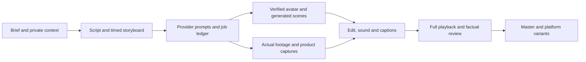

# Video production toolkit

Reusable tooling for product-marketing videos and personal avatar reels. This public core contains generic code, blank templates, local production skills and official-source research. It contains no personal profile, account IDs, credentials or private project links.

## Quick start

Python 3 is sufficient for planning. FFmpeg and ffprobe are required for local rendering. Run from videos/:

```sh
python3 scripts/video.py doctor
python3 scripts/studio.py init first-reel --track personal
python3 scripts/studio.py status projects/personal/first-reel
python3 scripts/studio.py pack projects/personal/first-reel
python3 -m unittest discover -s tests -v
```

Complete the brief/storyboard and supply private context before generation. For a ready planning example, use examples/personal-demo with status and pack. See [CLI.md](CLI.md) for optional --context and resumable provider job records. The commands make no remote provider calls.

## Production flow



[Production workflow](workflows/production.md) · [Provider runbooks](workflows/providers.md) · [Readiness checklist](workflows/setup-checklist.md) · [Ten local skills](skills/README.md)

## Tools and capabilities

The [research report](research/research-expanded.md) and [45-entry catalog](research/capability-catalog.json) cover generation, avatars/voice, editing, captions, sound, maps, 3D, quality, interchange and media storage. Sources and five upstream revision pins are included. Listings are research, not installed integrations or a claim that every tool is best for every shot.

For local clips, [assemble.py](ASSEMBLY.md) trims, normalizes and joins a JSON timeline with clip audio/silence or replacement narration. video.py probes and creates letterboxed vertical/landscape/square exports. Captions, music, transitions and creative finishing remain editor tasks.

## Private context

Keep context/preferences.json, persona.md, heuro.md, product-context.md and source-register.json in a private location. Supply that folder using --context. Store provider configuration and identity IDs privately. Real projects/generated prompts are ignored by Git because they can carry private supplied context. config/providers.example.json is an unconnected blank example. Do not place secrets or signed download URLs in any project file.

Local production skills are instructions for an assistant, not globally installed ChatGPT skills. Provider accounts, own-avatar selection, model runtime and final video quality require independent verification.

## New: product launch films

[Start here](START-HERE.md) for real product footage, founder integration, deterministic motion and a reproducible starter. [Official skill acquisition](research/skill-acquisition.md) records 14 fetched guidance skills across two pinned first-party repositories. [Launch-film stack](research/launch-film-stack.md) covers the capture/spatial/motion/finishing additions. External skill source checkouts stay in ignored vendor directories; run `python3 scripts/skill_sources.py --fetch` to retrieve the pinned sources in another environment.

The [motion starter](motion-starter/README.md) includes landscape/portrait compositions, labelled spatial demo graphics and real product/founder media slots. A short landscape render, portrait still and supplied-media checks passed in this workspace; a complete film still requires actual footage and a final edit.
